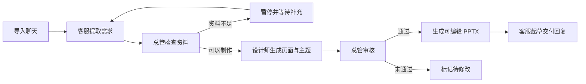

# PPT 接单多 Agent · 客服、总管与设计师

将顾客聊天或需求文本转为可编辑的 PowerPoint 初稿，并保留同一订单的澄清与修改记录。客服整理需求和回复草稿，总管判断资料是否齐全并审核设计结果，设计师生成页面内容和配色，最后由 `python-pptx` 写出 `.pptx`。

主流程使用 **LangGraph + DeepSeek**，本地 SQLite 保存订单检查点。客服回复供人审核和发送；项目不接入闲鱼、微信等聊天平台。

## 订单流程



客服提取主题、受众、页数、风格、交期和素材要求。总管结合模型判断与代码校验；缺主题、受众、页数或承诺提供的关键素材时进入 `needs_clarification`。设计师输出主题色和逐页标题、要点；总管对照顾客原话审核，未通过时停在 `needs_design_revision`，不会标记为已交付。

## 快速开始

需要 Python 3.10+、DeepSeek API Key 和项目依赖。以下命令均从仓库根目录执行。

```bash
pip install -r requirements.txt
```

复制 `.env.example` 为 `.env`，填写 `LLM_API_KEY`；模板已给出 DeepSeek 的 `LLM_BASE_URL` 和 `LLM_MODEL`。也可使用 `--env` 指向已有配置文件。`.env` 被 Git 忽略。

```bash
# 新订单：可以传一段文字，或 UTF-8 文本文件路径
python projects/p5_ppt_order_copilot/run_team.py "请做3页RAG切块入门PPT，面向大学生，蓝白简约风；内容包括概念、方法和检查点，明天下午交付。"
```

命令返回 `status`、`thread_id`、`customer_reply`、`state_file`；完成时还会返回 `pptx`。默认输出目录为 `outputs/`，检查点位于 `outputs/orders.sqlite`。记下 `thread_id`，后续操作使用同一个订单：

```bash
# status 为 needs_clarification：补充客户资料并恢复
python projects/p5_ppt_order_copilot/run_team.py --thread <thread_id> --resume "受众是大学生，素材就用刚才发的文字"

# status 为 draft_ready 或 needs_design_revision：提出修改
python projects/p5_ppt_order_copilot/run_team.py --thread <thread_id> --feedback "第二页标题改成‘两种切块方法’，其他内容保持"
```

如果配置文件不在本项目根目录，在命令末尾加 `--env "你的配置文件路径"`。CLI 另支持 `--output` 和 `--database`。修改稿生成新的 PPTX 与 JSON 快照，旧文件不会被原地覆盖。

## 技术实现

| 层 | 当前实现 |
| --- | --- |
| 多角色编排 | `langgraph.StateGraph` 定义客服、总管、设计、审核和交付节点；条件边选择澄清或设计 |
| 状态与恢复 | `SqliteSaver` 按 `thread_id` 保存订单；`interrupt` / `Command(resume=...)` 处理资料补充 |
| 模型调用 | `agentkit/llm.py` 通过 OpenAI 兼容接口调用 DeepSeek；`team.py` 保存逐角色模型轨迹 |
| 文件生成 | `python-pptx` 把标题、要点、三色主题写入可编辑的 16:9 PPTX |
| 输入保护 | 聊天和修改意见进入图之前做个人信息脱敏；设计师输出做结构校验 |

生成器目前使用统一的标题、要点和强调色版式。DeepSeek 在这里处理**文本需求和结构化页面内容**，不能直接看顾客截图，也没有视觉审美评估器。“照这张图调整排版”一类需求，需要人将视觉反馈描述为文字，或另接有视觉能力的模型。成品仍需人工检查版式、溢出和事实内容。

## 验证与已有记录

```bash
python -m unittest discover -s tests
python tests/smoke_standalone.py
python evals/run_eval.py

# 真实 DeepSeek 样本：会调用 API，并生成新的 PPTX/订单快照
python scripts/run_live_graph_eval.py
```

[`runs/graph_live/report.json`](runs/graph_live/report.json) 记录了 `deepseek-chat` 实际执行的完整需求、顾客修改、缺素材暂停、补充后恢复 4 条路径，列出每次角色调用和成品路径。这是小样本链路验证，不代表真实客户满意度或视觉设计质量。旧的 [`evals/report.json`](evals/report.json) 属于离线规则报价流程，其指标不能作为当前多 Agent PPT 生成效果。

仓库还保留 [`run_demo.py`](projects/p5_ppt_order_copilot/run_demo.py) / [`workflow.py`](projects/p5_ppt_order_copilot/workflow.py) 的离线报价与人工确认演示。它使用旧的确定性规则，不属于上述 LangGraph 制作流程，也不会生成 PPTX。体验当前多角色主流程请用 `run_team.py`。

## 代码导览

| 路径 | 作用 |
| --- | --- |
| [`projects/p5_ppt_order_copilot/run_team.py`](projects/p5_ppt_order_copilot/run_team.py) | 新建、恢复、修改订单的 CLI |
| [`projects/p5_ppt_order_copilot/graph_team.py`](projects/p5_ppt_order_copilot/graph_team.py) | LangGraph 状态、节点和条件路由 |
| [`projects/p5_ppt_order_copilot/team.py`](projects/p5_ppt_order_copilot/team.py) | 角色提示词、模型调用与轨迹 |
| [`projects/p5_ppt_order_copilot/deck.py`](projects/p5_ppt_order_copilot/deck.py) | 可编辑 PPTX 写出 |
| [`docs/PROJECT_TECHNICAL_REPORT.md`](docs/PROJECT_TECHNICAL_REPORT.md) | 详细技术报告和功能边界 |

## 当前边界

没有聊天 UI、平台消息对接、自动报价支付、图片理解、多用户鉴权或自动发件能力。订单检查点和 JSON 快照保存在本机；客户回复草稿及 PPT 成品由人核对后再对外发送。
