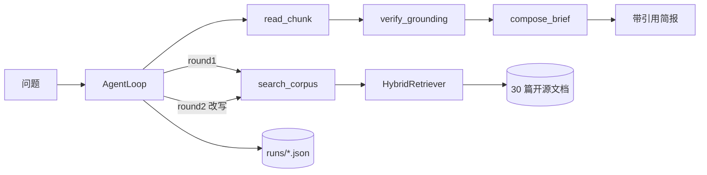
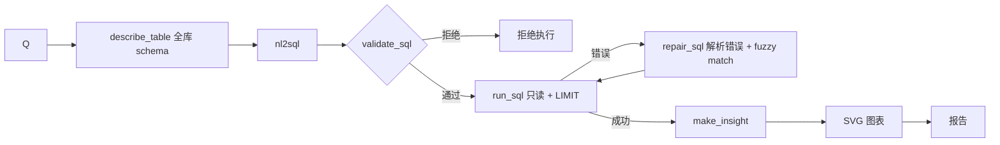
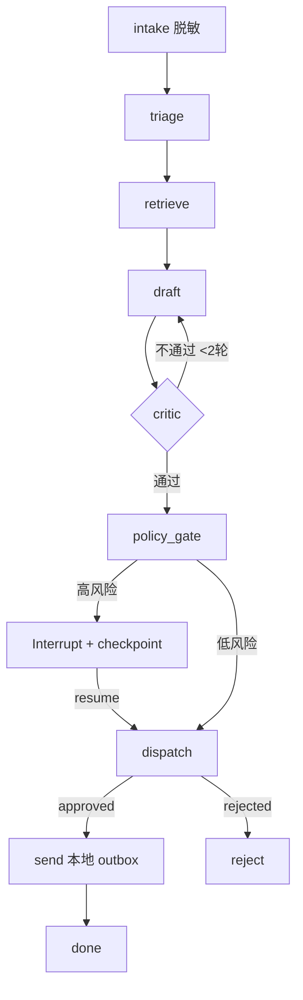
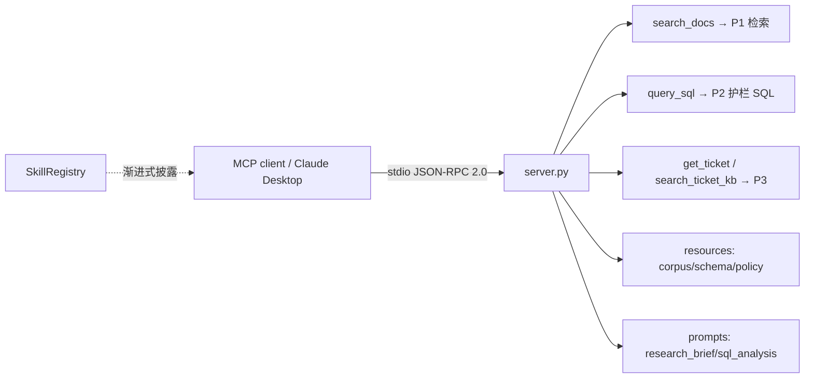
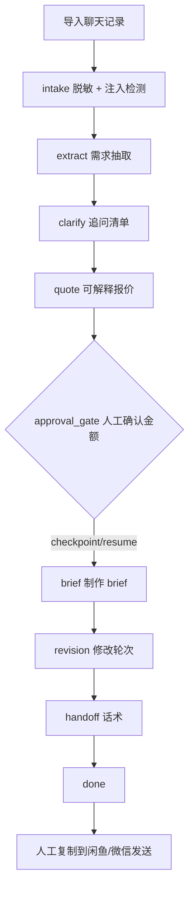

# 架构设计

## 设计目标

1. **可讲**：每个抽象都能在白板上画出来，不依赖框架黑盒；
2. **可跑**：零第三方依赖、零 API key、断网可运行；
3. **可测**：统一 eval harness，数值化，带回归门禁；
4. **可换**：LLM、检索器、图执行器、工具传输层都按接口可替换设计。

## 分层与依赖方向

```
projects/p1..p5  ──依赖──▶  agentkit/*  ──依赖──▶  Python 标准库
       │                        │
       │                        └──▶ data/（只读）
       └──▶ evals/ + tests/（反向验证）
```

`agentkit` 不 import 任何 project；projects 之间只有 P4 复用 P1/P2/P3 的**函数**（不是复制代码）。依赖方向单向，避免循环。

## 核心数据流

### P1 · 调研 Agent（agent loop，模型决定步数）



### P2 · SQL Agent（workflow + agentic 修复核心）



### P3 · 工单系统（显式状态机）



### P4 · 工具协议层



### P5 · 接单 Copilot（人机边界）



## 两种控制流：workflow vs agent

| 维度 | workflow（P3、P5、P2 主体） | agent（P1、P2 修复核心） |
|---|---|---|
| 控制流归属 | 开发者写死节点与边 | 模型运行时决定下一步 |
| 可预测性 | 高，易调试、易审计 | 低，需要预算与轨迹 |
| 成本 | 固定 | 随步数浮动 |
| 适用 | 步骤已知、含不可逆动作 | 检索角度/子任务无法预先确定 |

本作品集的立场与 Anthropic《Building Effective Agents》一致：**生产系统大多是 workflow，只在必要处嵌一个小的 agentic 核心**。P3 与 P5 涉及金额与对外发送，因此几乎全是 workflow + 人工审批。

## 关键抽象与替换映射

| 自研抽象 | 生产对应 | 替换成本 |
|---|---|---|
| `agentkit.loop.AgentLoop` | LangGraph `create_react_agent` / OpenAI Agents SDK | 换 loop，工具与 trace 不变 |
| `agentkit.state.Graph` | LangGraph `StateGraph`（node/conditional_edge/interrupt/`Command(resume=...)`） | 概念一一对应，约 1 个适配层 |
| `agentkit.rag.HybridRetriever` | BGE-M3 embedding + Qdrant/pgvector + cross-encoder rerank | 实现 `search()` 返回 `Hit` 列表即可 |
| `agentkit.tools.ToolRegistry` | MCP tools / OpenAI function calling schema | schema 格式已一致 |
| `agentkit.trace.Tracer` | OpenTelemetry / Langfuse / Phoenix | span 形状对齐后导出 |
| `agentkit.eval.EvalSuite` | LangSmith / Ragas / promptfoo | 指标定义与门禁逻辑可复用 |
| `p4 server.py` | `mcp` / `fastmcp`（仓库已给适配器） | 直接换 |

## 运行模式切换

```
LLM_API_KEY 为空  →  ScriptedLLM（确定性策略）  →  离线 / CI / 可复现评测
LLM_API_KEY 有值  →  OpenAICompatibleLLM       →  真实生成 / 同一套 eval 对比
```

`BaseLLM.chat(messages, tools)` 是唯一契约。所有项目只在构造 LLM 对象处分叉，其余代码完全一致。

## 数据流与产物

| 输入 | 处理 | 产物 |
|---|---|---|
| 30 篇开源文档 | 分块 → 双路索引 → RRF | 带 `[n]` 引用的简报、`runs/*.json` |
| Chinook DB | schema → SQL → 护栏 → 执行 | Markdown 报告 + SVG 图表 |
| 400 条工单 | 分诊 → 检索 → 起草 → 审核 → 审批 | 工单报告 + `runs/outbox.jsonl` |
| 聊天导入 | 抽取 → 报价 → 审批 → brief | 需求确认单 + 可复制话术 |
| 全部 | EvalSuite 聚合 | `evals/report.html` / `report.json` |
