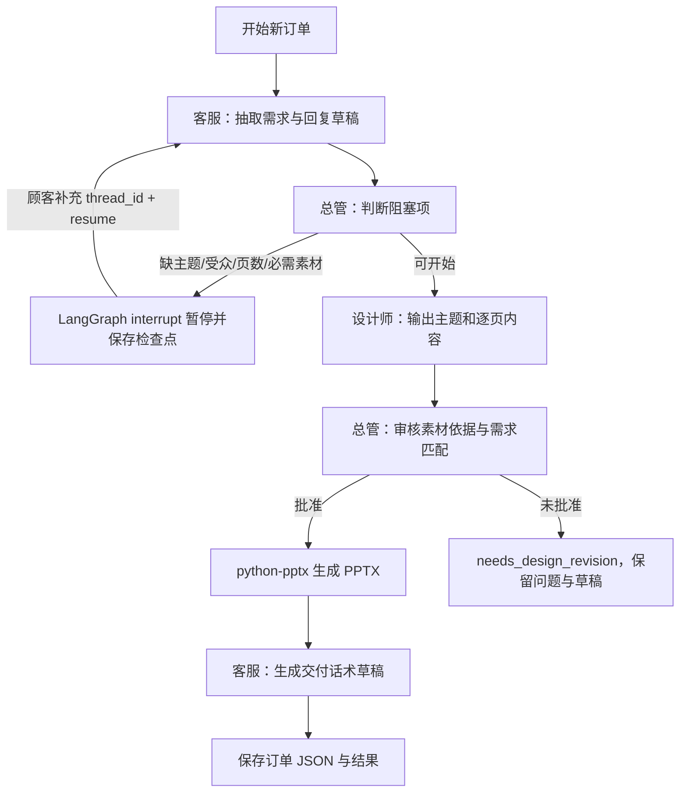

# P5 PPT 接单多 Agent 技术报告

更新日期：2026-11-20

## 项目概述

PPT 接单辅助工具把导入的顾客聊天转成需求、澄清问题、设计稿、可编辑 PPTX 和顾客回复草稿。系统不连接闲鱼或微信，也不自动发消息。真实模型路径由 LangGraph 编排客服、总管、设计师；旧的报价审批演示仍在 `workflow.py`，不等同于新的模型驱动 PPT 生产流程。

## 技术栈与框架

| 层 | 当前实现 |
|---|---|
| 语言 | Python 3.10+ |
| Agent 编排 | LangGraph `StateGraph`；分节点状态流、条件路由、`interrupt` 与恢复 |
| 检查点 | `langgraph-checkpoint-sqlite` 的 `SqliteSaver`；订单状态存本地 SQLite |
| 模型 | 项目 `OpenAICompatibleLLM` 适配器；本项目评测使用 DeepSeek API |
| PPTX | `python-pptx`，生成可编辑文本框与配色主题 |
| 安全/数据 | 本地 JSON 状态快照；输入聊天和反馈经 PII 脱敏；不接外部聊天平台 |
| 测试/评测 | `unittest`；真实模型图样本脚本写入 `runs/graph_live/` |

CrewAI、AutoGen 不在此项目的真实路径中。LangGraph 负责执行顺序和持久状态；角色提示词与调用仍由项目 `OrderTeam` / 模型适配层完成。

## 真实模型图



正常流程为客服整理信息、总管分流、设计师产出、总管审核、生成 PPT 并写交付话术。澄清订单使用 SQLite `thread_id` 暂停并恢复；已生成的订单通过同一个 `thread_id` 接收 `--feedback`，保留之前需求和幻灯片供设计师修改。

## 各功能如何实现

### 1. 聊天导入、隐私和需求提取

- 入口：`projects/p5_ppt_order_copilot/run_team.py`。
- `graph_team.OrderGraph.start()` 在新线程建立初始状态并做 PII 脱敏。
- `customer_service` 节点通过 DeepSeek 抽取 topic、audience、style、pages、deadline、source materials 和修改意见。
- `supervisor` 返回阻塞原因；代码对主题、受众、页数等关键字段做校验，缺项会停下来等待用户输入。截止时间可以粗略给出，交付格式默认为 PPTX。

### 2. 检查点、澄清和修改

- LangGraph `StateGraph` 声明节点、起点、条件边与结束状态。
- 澄清节点使用 `interrupt()` 将回复问题交还给 CLI；检查点保存状态，后续用 `Command(resume=...)` 恢复同一线程。
- `revise(thread_id, feedback)` 检查订单状态，只允许对已完成或需要设计修订的订单发起修改回合，并递增 `revision_round`。
- SQLite 是本机轻量持久化实现；不提供多用户鉴权、远程数据库或生产级高并发服务。

### 3. 设计、审核与 PPT 文件

- `designer` 返回 `theme` 和 `slides[]`，每页包含标题与 bullets；输入包括结构化需求、修改反馈和旧稿。
- `supervisor` 将幻灯片与需求、原始聊天和修改反馈对照；未批准时写入 `needs_design_revision` 与问题列表，不伪称完成。
- `deck.py` 调用 `python-pptx` 设置页面、底色、强调色、标题和项目符号，保存为可编辑 `.pptx`。
- `customer_service` 输出交付话术草稿；解析支持 `reply`、`content.message`、`content.summary/next_step` 等响应格式。
- 生成 PPT 的内容仍需人工核对，模型审核不是事实正确性的保证。

### 4. 日志和状态

- LangGraph checkpoint 存在 `outputs/orders.sqlite`（可由 `--database` 改位置）。
- 每次返回一个 `thread_id`，同一订单澄清和修改都使用它。
- 每次结果快照为 JSON，记录阶段状态、需求、slides、话术、脱敏字段及逐角色模型轨迹；不会记录 API key。
- 模型回复内容可能包含客户数据，使用前应遵循团队的数据保留政策；不要把 `.env` 放进版本库。

### 5. 兼容的旧离线报价流程

`projects/p5_ppt_order_copilot/workflow.py` 和 `run_demo.py` 保留原来的确定性报价和人工确认示例；价格公式由 `pricing.py` 计算，图中报价 gate 用项目内 `agentkit.Graph`/`Interrupt`。该路径不是新 LangGraph 订单图，也不生成 PPT 文件。

## 启动与配置

```env
LLM_API_KEY=你的DeepSeek密钥
LLM_BASE_URL=https://api.deepseek.com/v1
LLM_MODEL=deepseek-chat
```

依赖安装：

```powershell
pip install -r requirements.txt
```

新订单（可传自然语言，也可传 UTF-8 文本文件）：

```powershell
python projects/p5_ppt_order_copilot/run_team.py "制作一份3页RAG入门PPT，面向大学生，内容包括切块概念、常见方法、检查点" --env "D:\Pro Study\Agent Learning\p1_research_agent\.env"
```

从输出复制 `thread_id`。澄清后继续：

```powershell
python projects/p5_ppt_order_copilot/run_team.py --thread <thread_id> --resume "面向大学生，按标题和固定长度两种方法讲，今天下午交付" --env "D:\Pro Study\Agent Learning\p1_research_agent\.env"
```

对初稿提出修改：

```powershell
python projects/p5_ppt_order_copilot/run_team.py --thread <thread_id> --feedback "请把第二页标题改为两种方法，保持其他内容" --env "D:\Pro Study\Agent Learning\p1_research_agent\.env"
```

如果密钥已在环境变量，可省略 `--env`。`--previous` 仍可读取旧 JSON 文件并运行旧 `OrderTeam` 路径。

## 代码入口

| 功能 | 文件 |
|---|---|
| LangGraph 状态与角色节点 | `projects/p5_ppt_order_copilot/graph_team.py` |
| CLI 与订单续跑 | `projects/p5_ppt_order_copilot/run_team.py` |
| 角色调用与旧模型编排器 | `projects/p5_ppt_order_copilot/team.py` |
| PPTX 输出 | `projects/p5_ppt_order_copilot/deck.py` |
| 旧报价图与业务串接 | `projects/p5_ppt_order_copilot/workflow.py` |
| 价格和需求规则 | `projects/p5_ppt_order_copilot/pricing.py` |
| 模型 HTTP 接口 | `agentkit/llm.py` |

## 验证与限制

`tests/test_graph_team.py` 覆盖检查点恢复、同订单修改、选填截止时间不阻塞设计、关键字段缺失阻塞。`tests/test_team.py` 覆盖旧角色编排与 PPTX 文件结构。`scripts/run_live_graph_eval.py` 使用真实 DeepSeek 跑完整需求、修改、缺资料暂停和恢复的代表样本；报告与真实 PPTX 在 `runs/graph_live/`。这些少量样本证明这些路径可运行，不代表一般接单成功率。

目前没有客服 UI、多用户服务、平台消息 API、自动发送、收费系统、图表数据验证服务或真实客户历史数据集。客户回复与生成的 PPT 需人工检查后再发送或交付。SQLite 文件和结果快照应纳入合适的备份与隐私管理。
