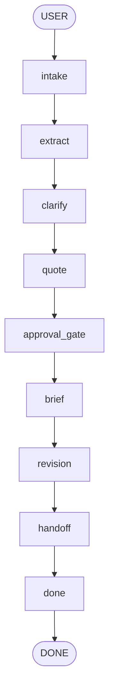

# PPT 接单 Copilot · 需求确认单 · c01_speech_to_ppt

> **边界**：本系统不接入闲鱼 / 微信任何接口。聊天记录为导入/粘贴，Agent 只产出需求单、报价单、制作 brief 与话术，**对外发送由人工完成**。

## 1. 需求抽取

- 任务类型：**演讲稿转 PPT**（speech_to_ppt）
- 页数：20；风格：简约
- 交付：后天；加急：否
- 附加项：charts；置信度：1.0

## 2. 可解释报价

| 项目 | 金额（元） |
| --- | ---: |
| 基础服务费（演讲稿转 PPT） | +12 |
| 按页计费 20 页 × ¥1.6/页 | +32 |
| 图表/数据可视化 | +5 |
| 区间钳制 [10, 60] | +0 |

**合计 ¥49**（规则钳制区间 ¥10–¥60；钳制生效：否）

公式：`setup(12) + per_slide(1.6)×pages + extras + urgency, clamp[10,60]`

## 3. 待确认问题（信息不足时主动追问）

- 无，信息完整

## 4. 修改轮次

第 0 轮修改在免费范围内（共 2 轮）。
（免费 2 轮，超出每轮 +¥5）

## 5. 人工审批

- 审批结果：{'approved': True, 'reviewer': 'human:seller', 'reason': '报价需人工确认：¥49（区间 10–60 元）。对外承诺金额前必须由人拍板。'}
- 提示注入信号：无
- 已脱敏字段：无

## 6. 对外话术（人工复制到闲鱼 / 微信）

```text
【可直接复制发送给客户的话术】

你好～我整理了一下需求：
· 类型：演讲稿转 PPT
· 页数：20 页
· 风格：简约
· 交付：后天
· 附加项：图表/数据可视化

报价明细：
  - 基础服务费（演讲稿转 PPT）：+12 元
  - 按页计费 20 页 × ¥1.6/页：+32 元
  - 图表/数据可视化：+5 元
  = 合计 **¥49**（价格区间 10–60 元）

修改规则：免费 2 轮，超出每轮 +¥5。
确认没问题的话我就按这个排期开始做啦～
```

## 7. 制作 brief

## 制作 brief（给执行者）

- 任务类型：演讲稿转 PPT
- 页数：20
- 风格：简约
- 交付：后天
- 附加项：charts
- 报价：¥49
- 需求置信度：1.0

执行清单：
1. 接收并归档素材（初版 PPT / 演讲稿 / 视觉参考）；
2. 按页数搭结构，逐页标注内容来源；
3. 统一母版、字体与配色；
4. 自查错别字、图片版权与导出兼容性；
5. 交付 PDF + 源文件，记录本轮修改点。

## 8. 流程轨迹

intake → extract → clarify → quote → approval_gate → brief → revision → handoff → done


## 状态图


